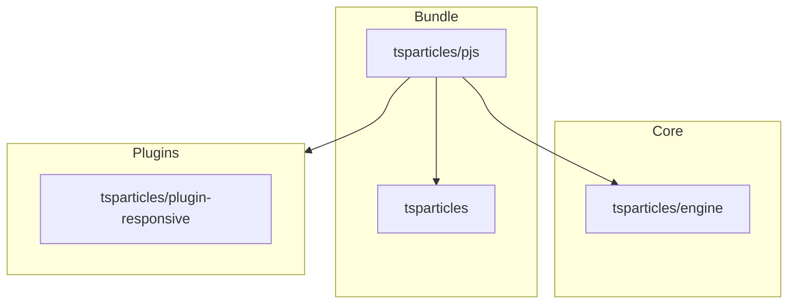

[](https://particles.js.org)

# tsParticles Particles.js Compatibility Package

[](https://www.jsdelivr.com/package/npm/@tsparticles/pjs) [](https://www.npmjs.com/package/@tsparticles/pjs) [](https://www.npmjs.com/package/@tsparticles/pjs) [](https://github.com/sponsors/matteobruni)

[tsParticles](https://github.com/tsparticles/tsparticles) particles.js compatibility library.

> [!WARNING]
> This package is legacy compatibility glue for particles.js-style APIs.
> Its compatibility APIs are deprecated. Use the engine APIs directly in new
> applications.

**Included Packages**

- [tsparticles (and all its dependencies)](https://github.com/tsparticles/tsparticles/tree/main/bundles/full)
- [@tsparticles/engine](https://github.com/tsparticles/tsparticles/tree/main/engine)
- [@tsparticles/plugin-responsive](https://github.com/tsparticles/tsparticles/tree/main/plugins/responsive)

## Dependency Graph



## Exposed API

The package exports only one API from its main entrypoint:

```ts
import { initPjs } from "@tsparticles/pjs";
```

`initPjs(engine)` takes an `Engine` and resolves to an object containing
`particlesJS`, `pJSDom`, and `Particles`. It registers the compatibility plugins
on the supplied engine and does not publish these APIs on `globalThis`.

## Installation

```bash
pnpm add @tsparticles/pjs @tsparticles/engine
```

## How it works

Calling `initPjs(engine)` performs these steps:

1. Checks runtime version compatibility.
2. Registers required plugins (`tsparticles` full bundle + responsive plugin).
3. Returns `particlesJS`, `pJSDom`, and `Particles` references bound to that
   engine.

Keep the returned references in application scope and use them after
initialization resolves.

## How to use it

### ESM / TypeScript

```ts
import { initPjs } from "@tsparticles/pjs";
import { createEngine } from "@tsparticles/engine";

const engine = createEngine();
const { particlesJS } = await initPjs(engine);

await particlesJS("tsparticles", {/* particles.js-style options */});
```

### CDN / Vanilla JS / jQuery

The CDN/Vanilla JS version has two files:

- One is a bundle file with all the scripts included in a single file
- One includes only `initPjs`, where dependencies must be loaded manually

The bundle exposes `tsParticles.createEngine` and `initPjs`. Create the engine,
await `initPjs(engine)`, and keep the returned compatibility references.

#### Bundle

Use the bundle when you want a single script with all required dependencies.

#### Not Bundle

This installation requires more work since all dependencies must be included in the page. Some lines above are all
specified in the **Included Packages** section.

### Usage

Using `particlesJS` compatibility:

```javascript
(async engine => {
  const { particlesJS } = await initPjs(engine);

  await particlesJS("tsparticles", {/* options */});
})(tsParticles.createEngine());
```

Using `Particles` compatibility:

```javascript
(async engine => {
  const { Particles } = await initPjs(engine);

  Particles.init({/* options */});
})(tsParticles.createEngine());
```

## Compatibility APIs returned by `initPjs`

| Returned API  | Description                                                                                          | Modern equivalent                                                    |
| ------------- | ---------------------------------------------------------------------------------------------------- | -------------------------------------------------------------------- |
| `particlesJS` | particles.js-compatible loader (including `.load` and `.setOnClickHandler`)                          | `engine.load`, `engine.loadJSON`, and the returned container methods |
| `pJSDom`      | array of containers created by the compatibility loader                                              | application-owned container references                               |
| `Particles`   | `marcbruederlin/particles.js` style wrapper (`init`, `pauseAnimation`, `resumeAnimation`, `destroy`) | `engine.load` plus the returned container methods                    |

Use explicit references in TS/JS code:

```ts
const { particlesJS, pJSDom, Particles } = await initPjs(engine);
```

#### Particles Options (only for Particles.init)

| Option             | Type               | Default   | Description                                                           |
| ------------------ | ------------------ | --------- | --------------------------------------------------------------------- |
| `selector`         | string             | -         | _Required:_ The CSS selector of your canvas element                   |
| `maxParticles`     | integer            | `100`     | _Optional:_ Maximum amount of particles                               |
| `sizeVariations`   | integer            | `3`       | _Optional:_ Amount of size variations                                 |
| `speed`            | integer            | `0.5`     | _Optional:_ Movement speed of the particles                           |
| `color`            | string or string[] | `#000000` | _Optional:_ Color(s) of the particles and connecting lines            |
| `minDistance`      | integer            | `120`     | _Optional:_ Distance in `px` for connecting lines                     |
| `connectParticles` | boolean            | `false`   | _Optional:_ `true`/`false` if connecting lines should be drawn or not |
| `responsive`       | array              | `null`    | _Optional:_ Array of objects containing breakpoints and options       |

##### Responsive Options

| Option       | Type    | Default | Description                                               |
| ------------ | ------- | ------- | --------------------------------------------------------- |
| `breakpoint` | integer | -       | _Required:_ Breakpoint in `px`                            |
| `options`    | object  | -       | _Required:_ Options object, that overrides default values |

#### Methods

| Method            | Description                         |
| ----------------- | ----------------------------------- |
| `pauseAnimation`  | Pauses/stops the particle animation |
| `resumeAnimation` | Continues the particle animation    |
| `destroy`         | Destroys the plugin                 |

## Compatibility status

- `particlesJS`, `pJSDom`, and `Particles` are deprecated compatibility APIs.
- This package is retained for particles.js integrations. New code should use
  the direct engine APIs.

See migration guide: [`markdown/pjsMigration.md`](../../markdown/pjsMigration.md)

## Common pitfalls

- Using the returned compatibility APIs before awaiting `initPjs(...)`
- Expecting `initPjs` to return `particlesJS`/`Particles` directly
- Expecting compatibility APIs on `globalThis`
- Mixing new `tsParticles` and legacy particles.js options in one config object

## Related docs

- All packages catalog: <https://github.com/tsparticles/tsparticles>
- Main docs: <https://particles.js.org/docs/>
